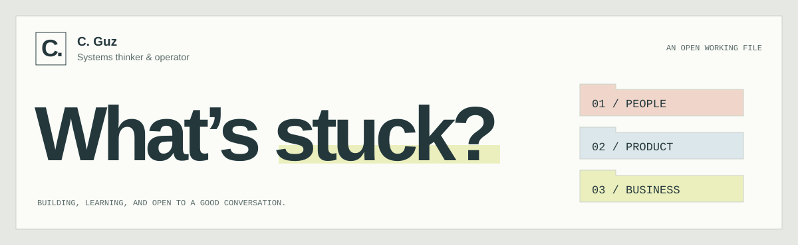

<a href="https://v0-c-me.vercel.app/?utm_source=github&amp;utm_medium=profile&amp;utm_campaign=operator_desk_20261025&amp;utm_content=banner#start">
  <picture>
    <source media="(prefers-color-scheme: dark)" srcset="assets/operator-desk-dark.svg">
    
  </picture>
</a>

I'm C., a **systems thinker and operator**. If the problem doesn't fit neatly into one role, we'll probably have something to talk about.

I pick up context quickly, ask a lot of questions, and work across people, product and the business around them. My degree is in psychology. Most of what came next, I taught myself by building, asking questions and taking responsibility for the work.

### Currently on my desk

**[H//DTC](https://hiredtctalent.org/?utm_source=github&utm_medium=profile&utm_campaign=operator_desk_20261025&utm_content=hdtc)**. I'm a precision headhunter for ecommerce founders, working on the hires they really need to get right. The business reached five figures in revenue in under three months.

Doing the searches myself means I can see where the work gets harder than it needs to be. So I'm building the tools I wish I'd had, to buy human time back. Using them in my own business is a fairly honest test of whether they help.

[What I'm building ↗](https://v0-c-me.vercel.app/?utm_source=github&utm_medium=profile&utm_campaign=operator_desk_20261025&utm_content=building#building) &nbsp; · &nbsp; [Two free hiring tools ↗](https://hiredtctalent.org/resources?utm_source=github&utm_medium=profile&utm_campaign=operator_desk_20261025&utm_content=tools)

### A few places I've been useful

**[01 / n8n. The hire that wasn't happening.](https://v0-c-me.vercel.app/?utm_source=github&utm_medium=profile&utm_campaign=operator_desk_20261025&utm_content=n8n#n8n)**

Five design hires in four months, after six months without one. I interviewed every member of the design team and built the design hiring playbook from zero with the Product Design Lead: evaluation criteria, interview structures, signal libraries and the assessment process. The incoming RPO received the playbook and Loom walkthroughs, with the judgment behind the process still attached.

**[02 / Paper Plan. The problem underneath the hiring request.](https://v0-c-me.vercel.app/?utm_source=github&utm_medium=profile&utm_campaign=operator_desk_20261025&utm_content=paper_plan#paper-plan)**

Approximately $12,700 saved each month through corrective action on mishires and software costs. I joined as Head of Talent and took on Chief of Staff responsibilities, working with the CEO on role fit, ownership, priorities and resource allocation through a leadership transition.

**[03 / Octopus. From discovery to first paying customers.](https://v0-c-me.vercel.app/?utm_source=github&utm_medium=profile&utm_campaign=operator_desk_20261025&utm_content=octopus#octopus)**

I recruited an AI engineer as CTO and led nine people across five time zones. I owned product, GTM, hiring, finance, operations and fundraising. We assessed 1,000+ candidates, helped employers make decisions 65% faster, and ran a six month beta with 100+ recruiters. Octopus is now closed. H//DTC is a separate business.

---

**Things I keep close:** Codex · v0 ♥ · Notion

I'm building, learning, and open to a team with an operating problem worth committing to, and the trust to take real ownership of it. Tell me what's going on and where it gets stuck. We can start there.

**[What's on your mind? ↗](https://v0-c-me.vercel.app/?utm_source=github&utm_medium=profile&utm_campaign=operator_desk_20261025&utm_content=conversation#about)**

[Open the working file](https://v0-c-me.vercel.app/?utm_source=github&utm_medium=profile&utm_campaign=operator_desk_20261025&utm_content=portfolio#start) &nbsp; / &nbsp; [C. on a page](https://v0-c-me.vercel.app/c-on-a-page?utm_source=github&utm_medium=profile&utm_campaign=operator_desk_20261025&utm_content=cv) &nbsp; / &nbsp; [LinkedIn](https://www.linkedin.com/in/cgenesis/)
